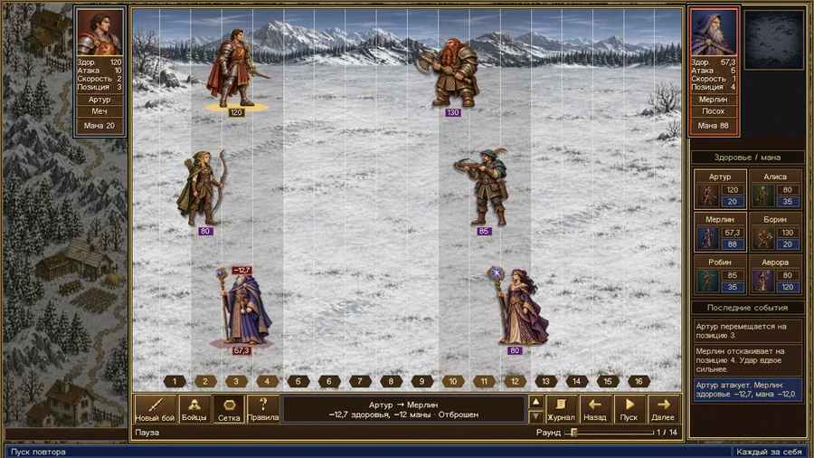

# Арена шести

На снежном перевале встречаются шесть бойцов. Каждый сражается за себя, а побеждает последний выживший. Запусти бой и посмотри, чем он закончится. Любой раунд можно пересмотреть.

Учебный проект по JavaScript с интерфейсом в духе Heroes III.



## Как запустить

В каталоге проекта запусти локальный сервер и открой [localhost:8000](http://localhost:8000).

```sh
python3 -m http.server 8000 --bind 127.0.0.1
```

Нажми **«Начать бой»**. Дальше бойцы ходят сами. За ход боец выбирает соперника с наименьшим здоровьем, сближается с ним и атакует, если хватает дальности оружия. Защитник может заблокировать удар или уклониться.

| Если хочешь… | Используй |
| --- | --- |
| Разобрать ход боя | **«Пауза»**, стрелки раундов, ползунок и **«Журнал»** |
| Посмотреть характеристики и позиции | **«Бойцы»** и **«Сетка»** |
| Пересмотреть тот же бой или начать новый | **«Повтор»** или **«Новый бой»** |

Сетка показывает позиции вдоль одной оси. Бойцы на поле разнесены по высоте, чтобы их было легче различить. Фиолетовые плашки показывают оставшееся здоровье.

## Как устроен код

- [Оружие](src/weapons.js) хранит дальность и прочность. От прочности зависит урон.
- [Бойцы](src/players.js) выбирают цели, двигаются, атакуют и защищаются. У шести классов разные характеристики и способности.
- [Движок боя](src/battle.js) проводит раунды и возвращает победителя через `play(players)`. Если к пределу раундов победитель не определился, функция возвращает `null`.
- [Интерфейс](arena.js) показывает состояния бойцов и события, которые записал тот же движок.

<details>
<summary>Как считаются спорные случаи</summary>

- Оружие с нулевой прочностью не добавляет урон к атаке бойца.
- Если бойцы стоят на одной позиции, дистанция считается равной единице. Цель смещается на шаг вправо, а расчётный урон удваивается.
- Если маны воина не хватает на весь удар, остаток урона снимается со здоровья.
- Гном считает удары, дошедшие до него после проверки защиты.

</details>

## Тесты

Нужны Node.js 20+ и npm.

```sh
npm ci
npm test
```

42 теста Jest проверяют оружие, способности, порядок хода и определение победителя. Покрытие строк движка – более 97% при пороге 70%.

[Условие задания](https://github.com/vovachebr/bhebdps-ojs/tree/master/%D0%94%D0%BE%D0%BC%D0%B0%D1%88%D0%BD%D0%B8%D0%B5%20%D0%B7%D0%B0%D0%B4%D0%B0%D0%BD%D0%B8%D1%8F/5%20%D0%98%D1%82%D0%BE%D0%B3%D0%BE%D0%B2%D0%BE%D0%B5%20%D0%B7%D0%B0%D0%B4%D0%B0%D0%BD%D0%B8%D0%B5) · [Источники иллюстраций, значков и шрифта](assets/README.md)
