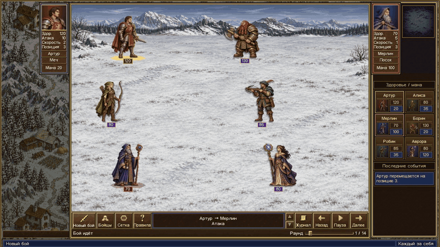
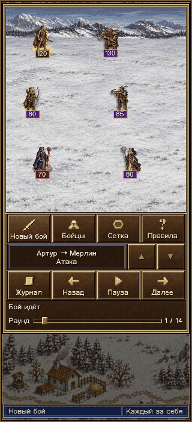

# Арена шести

Шесть бойцов сходятся на снежном перевале. Каждый сам выбирает цель, сближается и атакует. Побеждает последний, кто остался на ногах. Ты запускаешь бой и решаешь, какой момент пересмотреть.

Учебный проект по JavaScript с интерфейсом в духе Heroes III.

<a href="https://chupakobra6.github.io/javascript-final-rpg/">
  
</a>

<picture>
  <source media="(prefers-reduced-motion: reduce)" srcset="docs/arena.webp">
  
</picture>

## Как смотреть бой

- Нажми **«Начать бой»**. Золотая метка показывает, чей ход, красный пунктир отмечает цель. Результат атаки появляется рядом с целью и внизу экрана.
- Поставь бой на **«Паузу»**, чтобы рассмотреть ход. Стрелки и ползунок показывают конец выбранного раунда. В **«Журнале»** видны события до текущего момента.
- В окне **«Бойцы»** есть здоровье, мана, позиции и оружие. **«Сетка»** показывает позиции вдоль одной оси. По высоте бойцы разнесены для видимости.
- **«Повтор»** прокручивает тот же бой. **«Новый бой»** запускает другую симуляцию.

<details>
<summary>Посмотреть бой на узком экране</summary>



</details>

## Запуск из исходников

Из каталога проекта запусти сервер и открой [арену](http://localhost:8000).

```sh
python3 -m http.server 8000 --bind 127.0.0.1
```

## Как устроен код

| Часть | Что делает |
| --- | --- |
| [Оружие](src/weapons.js) | Задаёт дальность, прочность и урон. |
| [Бойцы](src/players.js) | Выбирают соперника с наименьшим здоровьем, сближаются, атакуют, блокируют и уклоняются. |
| [Движок боя](src/battle.js) | Проводит раунды и возвращает победителя через `play(players)`. При достижении лимита раундов возвращает `null`, если победителя ещё нет. |
| [Интерфейс](arena.js) | Записывает состояния бойцов по событиям движка и использует их при паузе, перемотке и повторе. |

<details>
<summary>Как считаются пограничные случаи</summary>

- Оружие с нулевой прочностью не добавляет урон к атаке бойца.
- Если бойцы стоят на одной позиции, дистанция считается равной единице. Цель смещается на шаг вправо, а расчётный урон удваивается.
- Если маны воина не хватает на весь удар, остаток урона снимается со здоровья.
- Гном считает удары, дошедшие до него после проверки защиты.

</details>

## Тесты

Нужны Node.js 20+ и npm.

```sh
npm ci
npm test
```

43 теста Jest проверяют оружие, способности, порядок хода, события боя и определение победителя. Покрытие строк движка – 97,5%. В Chrome проверены пауза, перемотка и повтор на широком и узком экранах, включая режим сокращённого движения.

[Условие задания](https://github.com/vovachebr/bhebdps-ojs/tree/master/%D0%94%D0%BE%D0%BC%D0%B0%D1%88%D0%BD%D0%B8%D0%B5%20%D0%B7%D0%B0%D0%B4%D0%B0%D0%BD%D0%B8%D1%8F/5%20%D0%98%D1%82%D0%BE%D0%B3%D0%BE%D0%B2%D0%BE%D0%B5%20%D0%B7%D0%B0%D0%B4%D0%B0%D0%BD%D0%B8%D0%B5) · [Источники иллюстраций, значков и шрифта](assets/README.md)
